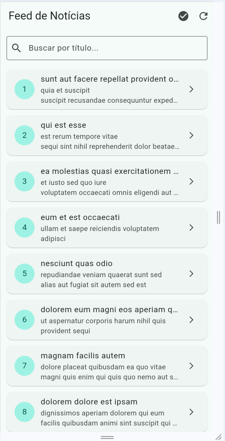
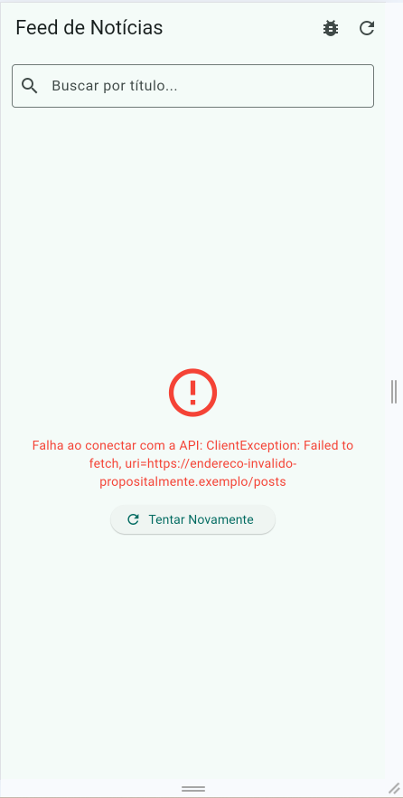
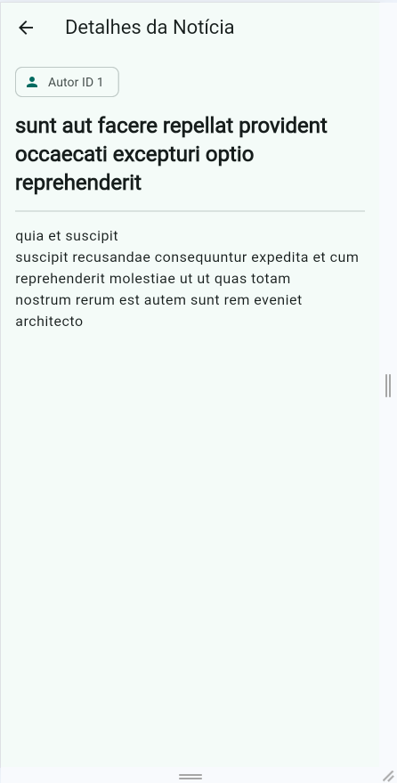

# Atividade 10 — Consumo Avançado de APIs, Listas e Exceções

Disciplina: Programação para Dispositivos Móveis I (Flutter) — Prof. Diego Menegassi

App de **feed de notícias** que consome a API REST [JSONPlaceholder](https://jsonplaceholder.typicode.com/posts), trata os 4 estados essenciais de uma tela assíncrona (**carregando**, **sucesso**, **vazio** e **erro**) e usa `try/catch/finally` para tratamento defensivo de exceções.

## Estrutura de pastas

```
lib/
├── models/
│   └── noticia_model.dart          # Modelo imutável + factory fromJson
├── services/
│   └── noticia_service.dart        # Requisição HTTP e tratamento de exceções
├── screens/
│   ├── feed_noticias_screen.dart   # Lista com os 4 estados, busca e simulação de erro
│   └── detalhe_noticia_screen.dart # Tela de detalhes da notícia
└── main.dart                       # MaterialApp (Material 3, seed teal)
```

## Níveis implementados

- **Básico:** campo de busca (`TextField`) abaixo da AppBar que filtra as notícias pelo título em tempo real.
- **Intermediário:** ao tocar em um card, abre a `DetalheNoticiaScreen` via `Navigator.push`, com autor, título e texto completo.
- **Avançado:** botão na AppBar (`bug_report` / `check_circle`) que troca o endpoint por um endereço inválido, forçando a tela de erro com o botão **"Tentar Novamente"**.

## Como executar

```bash
cd Atividade-10
flutter pub get
flutter run -d chrome
```

Para rodar os testes do modelo:

```bash
flutter test
```

## Evidências

### Feed de notícias com busca


### Erro de conexão (Nível Avançado)


### Tela de detalhes (Nível Intermediário)

